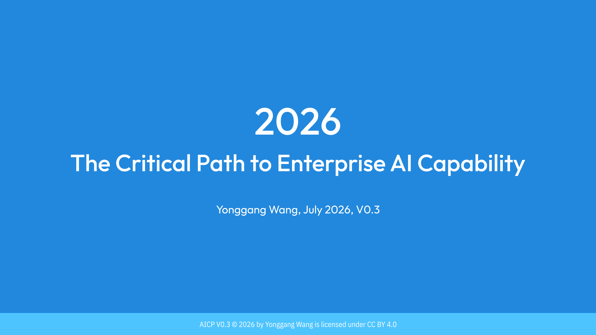
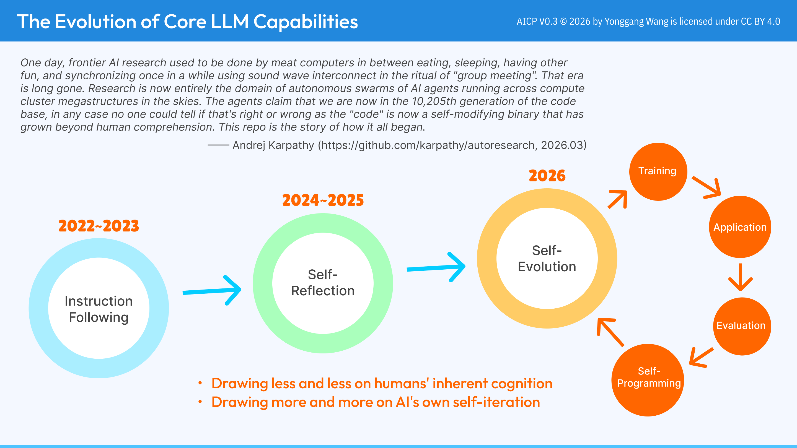
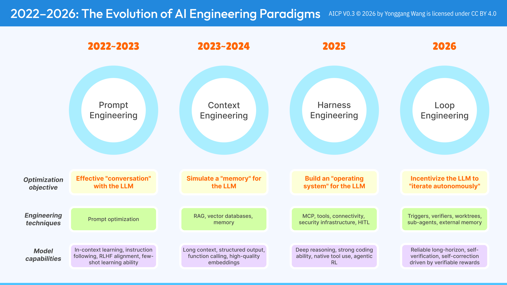
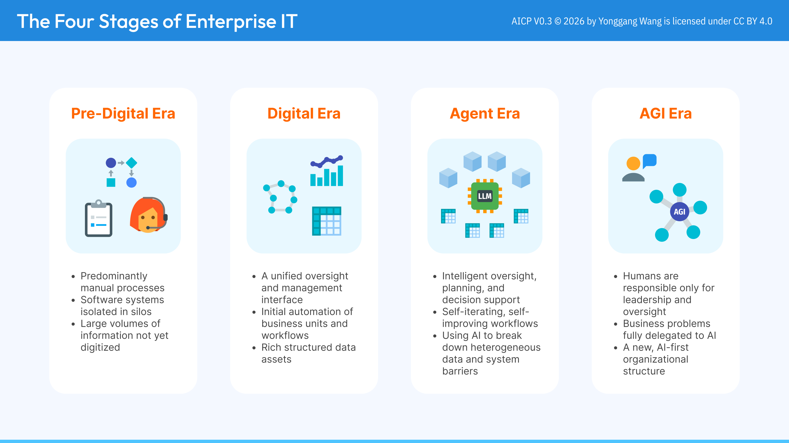
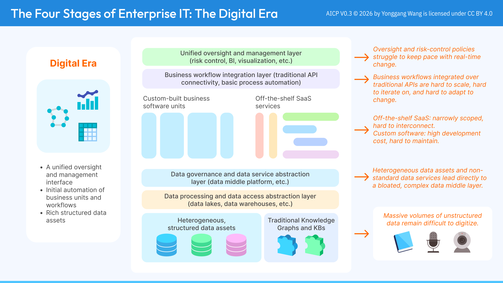
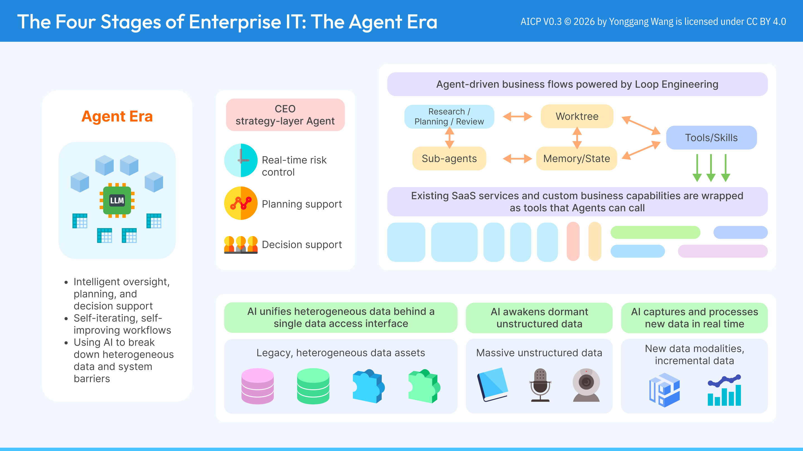
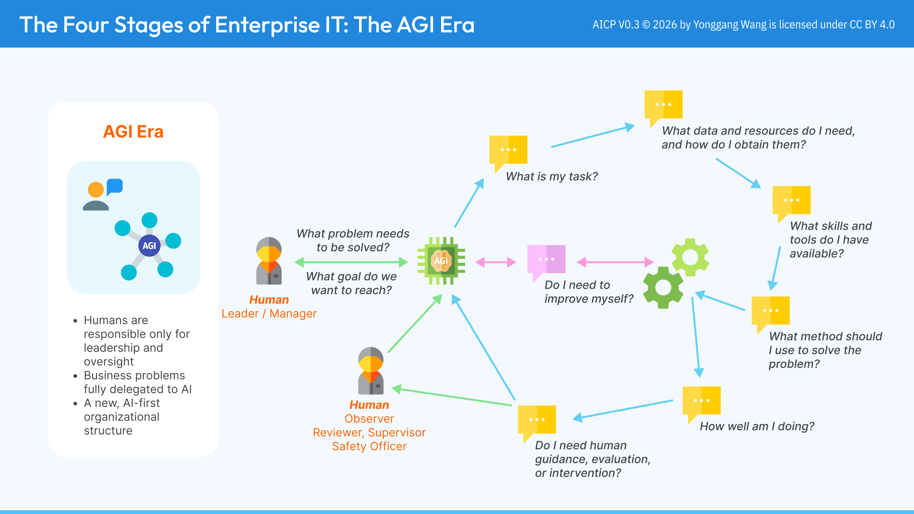
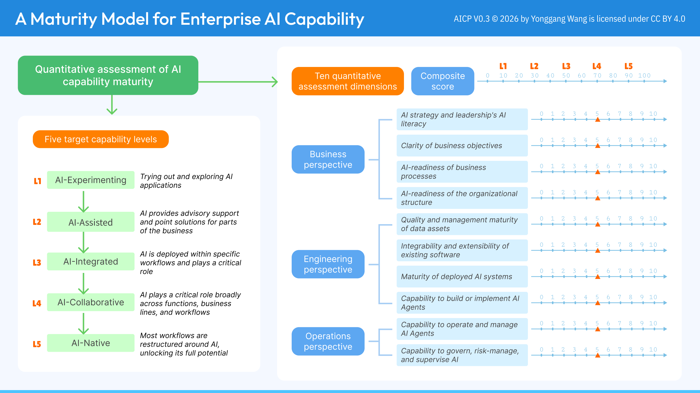
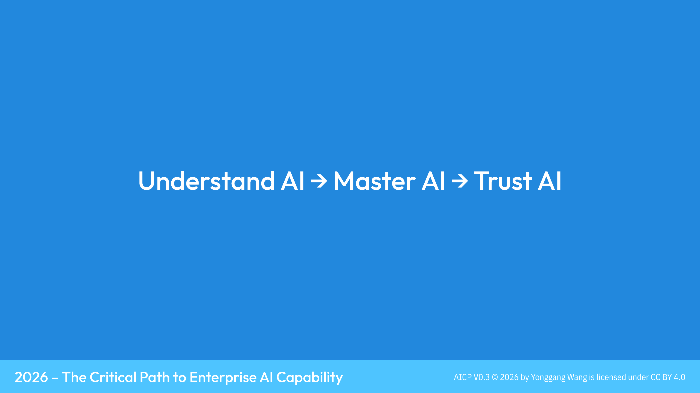

# 2026 - The Critical Path to Enterprise AI Capability

AICP: a diagram set on the critical path enterprises follow while building AI capability.
This is a translation of [the original Chinese diagrams](./README.md).

By Yonggang Wang, July 2026, V0.3

## LICENSE

This work is licensed under a
[Creative Commons Attribution 4.0 International License](http://creativecommons.org/licenses/by/4.0/).

## Cover

In 2026, more and more enterprises are running into the same paradox: after buying agents and burning through a sizable token budget, headcount hasn't shrunk, and revenue and costs haven't visibly improved. The root cause is rarely the AI itself — it's the illusion that AI is "plug-and-play," adopted without first understanding where the enterprise's own IT stands, and without deliberately designing how data, workflows, people, and AI should connect.

This diagram set offers a more grounded path: first understand AI, then master AI, and only then can trust in AI be earned. The nine diagrams that follow trace the evolution of core LLM capabilities and AI engineering paradigms, walk through the four historical stages of enterprise IT, and close with a quantifiable maturity model for enterprise AI capability — all in service of moving past "AI for AI's sake" and onto a more deterministic critical path.

## The Evolution of Core LLM Capabilities

Between 2022 and 2026, the core capabilities of large language models advanced through three leaps: from instruction following, to self-correcting self-reflection, to the still-emerging stage of self-evolution — where models iterate on themselves within a closed loop of training, application, evaluation, and self-programming. The direction is unmistakable: models are drawing less and less on humans' inherent cognition, and more and more on their own iterative self-improvement.

A string of 2026 developments reinforces this trend. On the open-source side, Moonshot AI published the Kimi K3 technical report in July: a 2.8-trillion-parameter, 104-billion-active-parameter open mixture-of-experts model with native vision understanding and a million-token context window — the first publicly released 3-trillion-parameter-class model. On the closed-source side, Anthropic's Claude Fable 5, launched in June and opened globally in July, can already run inside an agent harness for days at a time, planning across stages, delegating to sub-agents, and checking its own work. The fictional prophecy attributed to Andrej Karpathy in this diagram traces back to a real project he shipped in March 2026: autoresearch, an open-source loop that lets an AI agent run hundreds of machine-learning experiments overnight on a single GPU, rewriting its own training code, scoring the results, and keeping only the improvements that stick (it picked up more than 20,000 GitHub stars within its first week). The line reads less like a joke and more like an extreme extrapolation of this very curve — AI drawing less on human cognition and more on its own iteration.

## 2022-2026: The Evolution of AI Engineering Paradigms

If the evolution of model capability determines what AI can do, the evolution of engineering paradigms determines how humans harness that capability. From prompt engineering in 2022 — optimizing how to "converse" with an LLM — to context engineering in 2023, simulating a "memory" for the model; from harness engineering in 2025, building an "operating system" around the LLM, to loop engineering in 2026, incentivizing the LLM to "iterate autonomously" — each paradigm shift doesn't replace the one before it. It layers a new dimension of control on top.

In concrete terms, the prompt engineering era was mostly about crafting the prompt itself — role framing, few-shot examples, chain-of-thought prompting — to get more reliable answers out of a single- or multi-turn conversation. The context engineering era introduced RAG (retrieval-augmented generation) and vector databases (Milvus, Pinecone, and the like), feeding an enterprise's private knowledge into the model as embeddings and compensating for its lack of built-in long-term memory and domain knowledge. The harness engineering era is marked by the emergence of standardized protocols such as MCP (Model Context Protocol), which let an LLM call external tools and data sources safely and consistently, layered with permissioning, audit logs, and human-in-the-loop approval — building a trustworthy "operating system" around the model. By the loop engineering era, worktrees, verifiers, sub-agents, and external memory are combined so AI can repeatedly trigger, execute, self-verify, and self-correct around a goal unattended, until it reaches a verifiable result.

It's worth stressing that this chain is far from finished. AI capability is advancing faster than engineering paradigms can settle, and new paradigms will keep emerging to harness whatever the next generation of models unlocks.

## The Four Stages of Enterprise IT

Enterprise IT has broadly moved through four stages: the pre-digital era (manual processes, siloed systems, largely undigitized data), the digital era (a unified management interface, early automation, rich structured data assets), the agent era (AI providing intelligent oversight, planning, and decision support, with self-iterating workflows), and the AGI era (humans responsible only for leadership and oversight, business problems fully delegated to AI).

In concrete terms, pre-digital-era enterprises often still run core operations on spreadsheets, paper forms, and phone calls, with roles like customer service handling requests one by one through human operators. Digital-era enterprises have rolled out ERP and CRM systems and built basic operational visibility through BI dashboards, but data and processes still sit in silos across systems. Agent-era enterprises are starting to deploy AI agents that autonomously carry out multi-step tasks in specific scenarios — automatically triaging and resolving after-sales tickets, or generating a personalized follow-up plan from a sales lead. The AGI era, still a projection, imagines a company where the vast majority of business decisions and execution are carried out by AI, with human executives mostly signing off on and overseeing the strategic direction AI proposes.

It's worth noting these four stages aren't a single timeline that society marches through in lockstep — they're more of a measuring stick. Today, different enterprises sit at very different points on it: some mature organizations are already piloting agent-era automated workflows, while many startups haven't finished digitizing their basic business data and remain, in effect, in the pre-digital era, running point tasks manually on standalone tools. Recognizing which stage you're actually in is the first step in planning any AI capability roadmap.

## The Four Stages of Enterprise IT: The Digital Era

The biggest challenge of the digital era was never whether any single application worked well — it was integrating heterogeneous systems and heterogeneous data. Custom-built systems iterate slowly and cost a lot to maintain; off-the-shelf SaaS services are narrowly scoped and hard to interconnect; business workflows can only be stitched together point-to-point over traditional APIs, which is hard to scale and hard to adapt as requirements change.

Meanwhile, structured data ends up scattered across databases, data lakes, and data warehouses, forcing enterprises to build increasingly bloated and complex data middle-platforms just to govern it — while unstructured data, which makes up the larger share (documents, audio, video), mostly sits outside the reach of digitization altogether. Together these pain points formed a ceiling the digital era struggled to break through, and they are the reality enterprise IT lived with long before AI truly arrived.

This kind of integration complexity shows up everywhere in traditional enterprises: a retailer's e-commerce, inventory, and finance systems are often built by different vendors in different eras, so the same product's data has to be manually re-entered and reconciled across each one; a frontline support agent often has to jump between a CRM, a ticketing system, and a knowledge base just to answer one simple question. The industry has a name for this: "stovepipe systems" or "data silos" — every new business system an enterprise adds requires its own custom data-sync and integration work, so integration cost keeps climbing as the number of systems grows, until changing any single piece risks breaking several others.

## The Four Stages of Enterprise IT: The Agent Era

AI's real comparative advantage shows up exactly where the digital era got stuck: unifying heterogeneous data and connecting heterogeneous systems. Scattered structured data assets, dormant unstructured data, and continuously generated new data can all be wrapped behind a single, unified data-access interface; existing SaaS services and custom business capabilities can likewise be wrapped as tools and skills that agents can call.

But that advantage doesn't materialize on its own. Enterprises first have to integrate their data and connect their capabilities — only then can agents run their research/planning/review, sub-agent decomposition, memory/state management, and tool-calling loop on top of the richest possible data and toolset, and reach their best state of autonomous planning and execution. It's the age-old principle of "lay the foundation before building the tower," now playing out in the AI era.

In concrete terms, once data sits behind a single access interface and capabilities are wrapped as standardized tools, agent-era business flows start turning around a few loop-engineering stations: the agent first works out what it's trying to do at the "research/planning/review" node — clarifying the goal, breaking it into steps, and weighing feasibility; it then moves into a "worktree" node, where the task is actually carried out inside an isolated working environment; intermediate results, context, and the reasoning behind each decision get written to a "memory/state" node for long-term storage, so later steps or sub-agents can reuse them; and at each step, the agent calls on existing SaaS services and custom business capabilities — wrapped as tools/skills — as needed, feeding the results back into "research/planning/review" to keep the research-execute-remember-call loop turning until the task is verified as done.

For more complex work, this loop branches further into multiple sub-agents, each handling a slice of the task and reporting results back to the main flow; and at the top of the organization, a "CEO strategy-layer" agent takes shape, focused on real-time risk control and cross-workflow planning and decision support — freeing human executives from day-to-day execution so they only need to sign off on the strategic options AI proposes. This is loop engineering, introduced in "2022-2026: The Evolution of AI Engineering Paradigms," landing in a concrete business setting: the more thoroughly data and tools are integrated, the more complete and reliable the plan-and-execute loop an agent can run on its own becomes.

## The Four Stages of Enterprise IT: The AGI Era

As enterprises move into the AGI era, the human role in day-to-day operations shifts fundamentally: from executing tasks to setting goals and overseeing the process. AI takes on the full loop itself — from "what is my task" to "what method should I use to solve this problem," "how well am I doing," and "do I need human guidance" — while continually asking whether it needs to improve itself, and upgrading itself when it does.

In this picture, the human leader/manager poses the problems and goals; the human observer/reviewer/safety officer steps in at key checkpoints to guide, evaluate, and intervene; and AI itself carries the bulk of the work — understanding tasks, marshaling resources, choosing methods, and evaluating outcomes. This isn't about diminishing the human role — it's about concentrating human attention on the leadership and oversight that genuinely require judgment and wisdom.

## A Maturity Model for Enterprise AI Capability

The road to the AGI era can't be crossed in a single leap. Enterprises first need an honest, quantitative read on where their own AI capability actually stands. The maturity model shown here sets out five target capability levels — from L1 (AI-Experimenting) to L5 (AI-Native) — and ten quantitative assessment dimensions across three perspectives: business (AI literacy and leadership, clarity of objectives, process and organizational readiness), engineering (data quality, system integrability, agent-building capability), and operations (the capability to operate, govern, and risk-manage AI agents).

Only after this kind of self-diagnosis can an enterprise avoid a one-size-fits-all AI overhaul, and instead design a capability-building path that targets its actual weak points and advances step by step from where it truly stands.

## Closing

From understanding AI's capability boundaries and evolutionary logic, to mastering it — turning it into productivity through the right engineering paradigms and organizational design — to finally earning trust in AI, where humans can confidently hand over decision-making and execution: this path of understand AI, master AI, trust AI is the critical path this diagram set has tried to trace toward the AI-native enterprise.

## References

- [Kimi K3 (Moonshot AI)](https://huggingface.co/moonshotai/Kimi-K3) — the official model repository and technical report for a 2.8-trillion-parameter, 104-billion-active-parameter open mixture-of-experts model
- [karpathy/autoresearch](https://github.com/karpathy/autoresearch) — the open-source AI research-automation loop Andrej Karpathy released in March 2026, the real project behind the fictional quote in Figure 1
- [Claude Fable 5 (Anthropic)](https://www.anthropic.com/news/claude-fable-5-mythos-5) — the announcement of Anthropic's first Mythos-class frontier model
- [Gartner AI Maturity Model](https://www.gartner.com/en/chief-information-officer/research/ai-maturity-model-toolkit) — Gartner's enterprise AI maturity model and companion assessment toolkit
- [MIT CISR Enterprise AI Maturity Model](https://cisr.mit.edu/publication/2024_1201_EnterpriseAIMaturityModel_WeillWoernerSebastian) — MIT CISR's enterprise AI maturity model, based on a survey of 721 companies and a key reference for Figure 8
