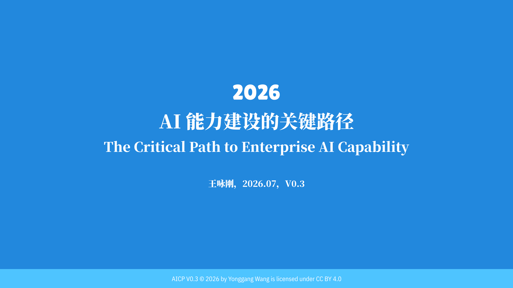
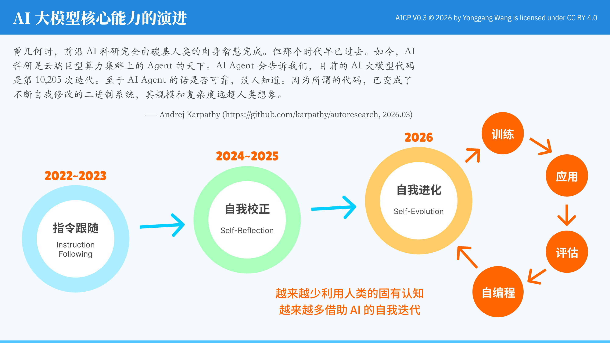
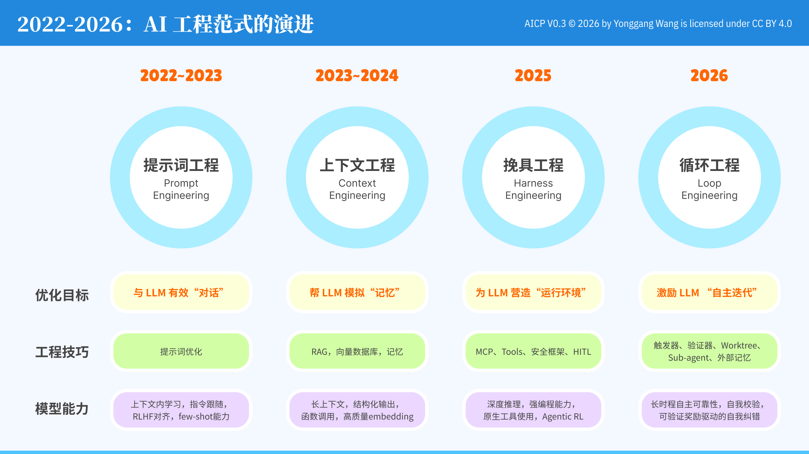
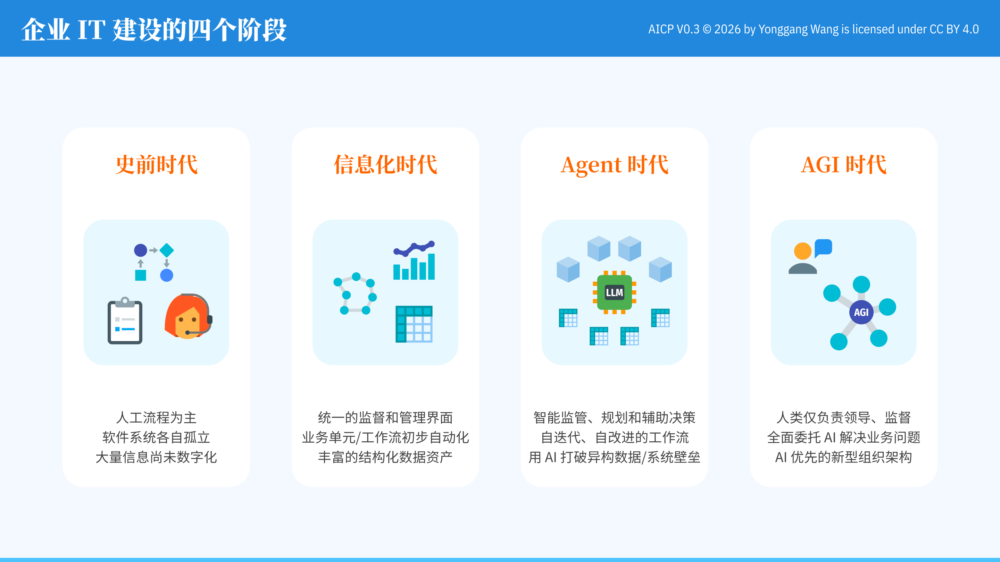
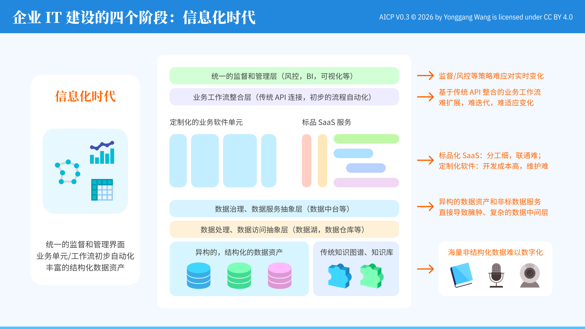
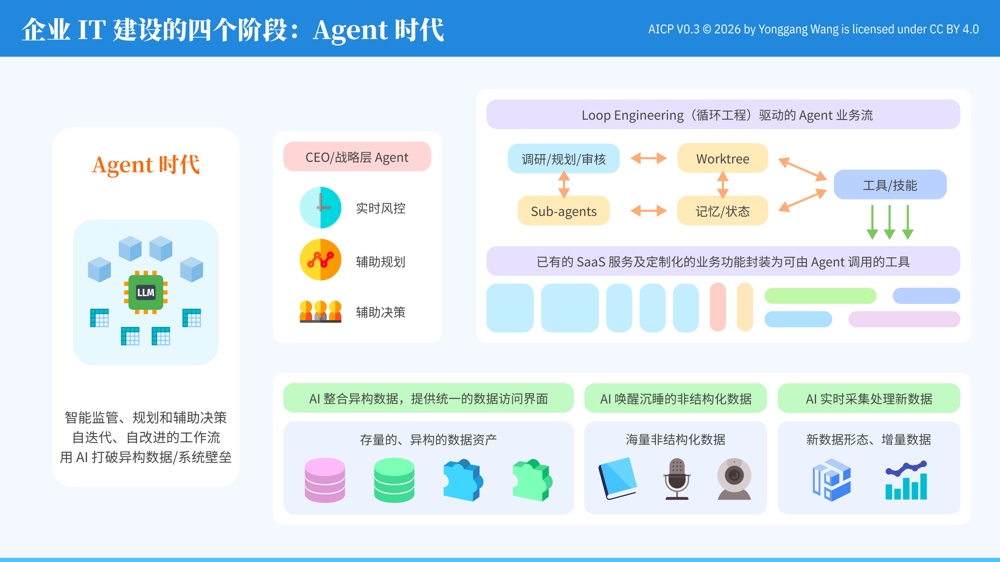
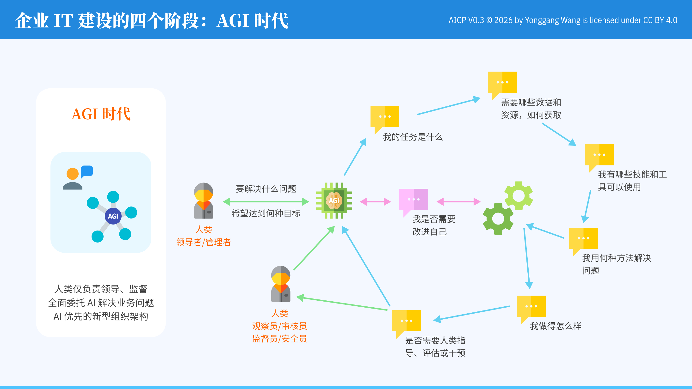
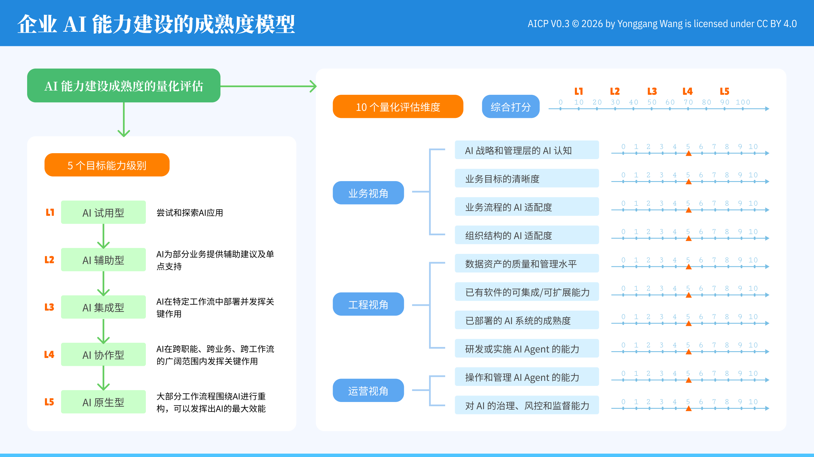
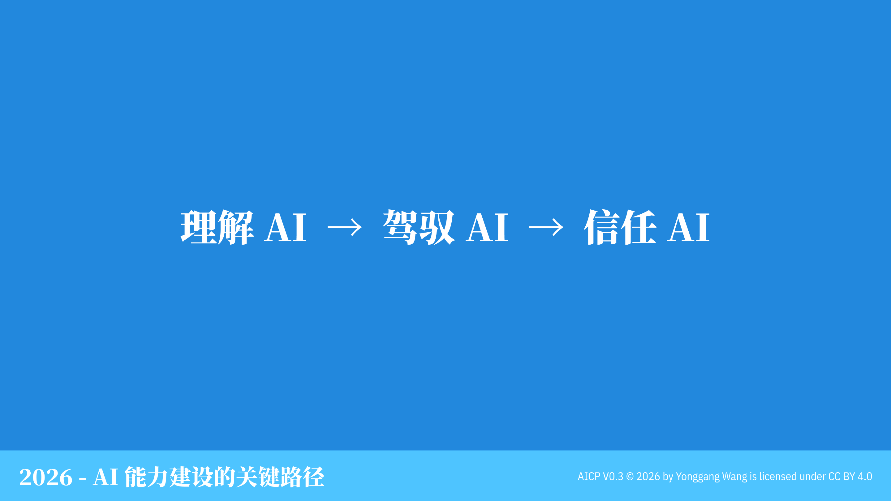

# 2026：企业AI能力建设的关键路径

AICP（The Critical Path to Enterprise AI Capability）：企业构建AI能力过程中的关键路径图集。

作者：Yonggang Wang，2026年7月，V0.3

## Localization

本图集的原始语言为中文。English translation: [README.en.md](./README.en.md).

## LICENSE

This work is licensed under a
[Creative Commons Attribution 4.0 International License](http://creativecommons.org/licenses/by/4.0/).

## 封面

2026年，越来越多企业正在经历一个共同的悖论：买了Agent、投入了可观的Token预算，人员没有减少，收入和成本也未见明显改善。根源往往不在AI本身，而在于一种"即插即用"的幻觉——企业在引入AI之前，既没有厘清自身IT建设所处的阶段，也没有认真设计数据、工作流、组织与AI之间应当如何连接。

本图集尝试提供一条更务实的路径：先理解AI（Understand AI），再驾驭AI（Master AI），最终才能建立起对AI的信任（Trust AI）。以下九张图依次回顾大模型核心能力与AI工程范式的演进、企业IT建设的四个历史阶段，并给出一套可量化的企业AI能力成熟度模型，希望帮助企业跳出"为AI而AI"的误区，走上一条更具确定性的关键路径。

## AI 大模型核心能力的演进

2022年到2026年，大模型的核心能力经历了三次跃迁：从指令跟随（Instruction Following），到具备自我校正能力的自我反思（Self-Reflection），再到如今初现端倪的自我进化（Self-Evolution）——模型开始在训练、应用、评估、自编程构成的闭环中持续迭代自身。这一演进的方向十分清晰：AI越来越少依赖人类的固有认知，越来越多依靠自身的自我迭代能力。

2026年的一系列进展进一步印证了这一趋势。开源阵营中，Moonshot AI 于7月发布了 Kimi K3 技术报告：一个2.8万亿参数、1040亿激活参数的开源混合专家模型，具备原生视觉理解与百万级上下文窗口，是首个公开权重的3万亿参数级模型。闭源阵营中，Anthropic 于6月发布、7月起面向全球开放的 Claude Fable 5，已经可以在Agent运行环境中连续工作数天，自主规划多阶段任务、调度子智能体，并对自己的工作成果进行检查。图中引用的Andrej Karpathy的虚构式预言，其原型正是他今年3月发布的开源项目 autoresearch——让AI Agent在单张GPU上通宵自动运行上百次机器学习实验，直接修改训练代码、评估效果并保留真正有效的改进（发布当周即斩获逾2万颗GitHub星标）。与其说这句预言是玩笑，不如说它是对"AI越来越依靠自我迭代"这条演进曲线的一种极端外推。

## 2022-2026：AI 工程范式的演进

如果说模型能力的演进决定了AI能做什么，那么工程范式的演进决定了人类如何驾驭这种能力。从2022年围绕"如何与LLM有效对话"的提示词工程，到2023年模拟"记忆"的上下文工程，再到2025年为LLM构建"操作系统"的挽具工程，直至2026年激励LLM"自主迭代"的循环工程——每一次范式跃迁，都不是对前一种范式的否定或替代，而是在其基础上叠加了一层新的控制维度。

具体来看，提示词工程时代的核心动作是打磨提示词本身——通过角色设定、少样本示例、思维链提示等技巧，让模型在单轮或多轮对话中给出更可靠的回答；上下文工程时代则引入了RAG（检索增强生成）与向量数据库（如Milvus、Pinecone），把企业私有知识以Embedding的形式接入模型的"记忆"，弥补模型天生缺乏长期记忆和领域知识的短板；挽具工程时代的标志是MCP（Model Context Protocol）等标准化协议的出现，它让LLM可以安全、规范地调用外部工具与数据源，同时叠加权限控制、审计日志与人工在环（HITL）审批，为AI构建起一套可信赖的"操作系统"；到了循环工程时代，Worktree、验证器（Verifier）、子智能体（Sub-agent）与外部记忆等机制被组合起来，让AI可以在无人值守的情况下，围绕一个目标反复触发、执行、自我验证、自我纠正，直到达成可验证的结果。

值得强调的是，这条演进链条远未到达终点。AI能力的进化速度远快于工程范式的沉淀速度，可以预见，未来还会持续涌现出新的工程范式，去驾驭下一代模型释放出的能力。

## 企业 IT 建设的四个阶段

企业IT建设大致经历了史前时代（人工流程为主、系统孤立、数据未数字化）、信息化时代（统一管理界面、初步自动化、结构化数据资产）、Agent时代（AI提供智能监管、规划与决策支持，工作流自我迭代）与AGI时代（人类仅负责领导与监督，业务问题全面委托AI）四个阶段。

具体来看，史前时代的企业往往还在用Excel、纸质表单和电话沟通来运转核心业务，客服等岗位高度依赖人工话务员逐一处理需求；信息化时代的企业已经普及了ERP、CRM等业务系统，用BI报表实现基本的经营监控，但不同系统之间的数据和流程仍然彼此割裂；Agent时代的企业开始在客服、销售、财务等具体场景中部署能够自主执行多步骤任务的AI Agent，例如自动完成售后工单的排查与处理、根据销售线索自主生成个性化跟进方案；而AGI时代作为一种展望，则设想企业的绝大多数经营决策与执行都由AI完成，人类高管的角色更接近于对AI提出的战略方向进行拍板和监督。

需要提醒的是，这四个阶段并非社会整体按统一节奏推进的时间线，而更像是一把量尺：今天，不同企业可能正分处于完全不同的坐标上——一些成熟企业已经在探索Agent时代的自动化工作流，而不少初创公司大量业务数据尚未完成基本的数字化，仍停留在依靠人工与单机工具处理单点任务的史前时代。认清自己所处的真实阶段，是规划AI能力建设的第一步。

## 企业 IT 建设的四个阶段：信息化时代

信息化时代最大的难题，从来不是某一个应用做得好不好，而是异构系统与异构数据之间的整合。自建业务系统迭代慢、维护成本高；采购的SaaS服务功能单一、彼此难以互通；业务流程只能依靠传统API做点对点的连接，既难以扩展，也难以随需求变化快速调整。

与此同时，结构化数据被分散锁在不同的数据库、数据湖和数据仓库中，企业不得不构建越来越臃肿复杂的数据中台去做统一治理；而占比更高的非结构化数据——文档、音频、影像——则大多游离在数字化范围之外，难以被真正利用。这些痛点共同构成了信息化时代难以突破的天花板，也是AI真正登场之前，企业IT建设长期面对的现实。

这类整合的复杂度在传统企业中随处可见：一家零售企业的电商系统、库存系统和财务系统往往由不同厂商在不同年代分别建设，同一件商品的数据需要人工在多个系统里反复录入和核对；一线客服人员为了回答一个简单问题，常常需要在CRM、工单系统与知识库之间来回切换查询。业内把这种状态称为"烟囱式系统"或"数据孤岛"：企业每新增一个业务系统，就要额外搭一套定制化的数据同步与接口对接，集成成本随着系统数量增加而不断攀升，直到修改任何一个环节，都可能牵一发而动全身。

## 企业 IT 建设的四个阶段：Agent 时代

AI真正的比较优势，恰恰体现在信息化时代最难解决的问题上：打通异构数据、连接异构系统。无论是分散的结构化数据资产、沉睡的非结构化数据，还是持续产生的新数据，AI都能够将其统一封装到一个数据访问接口之下；已有的SaaS服务与自建业务能力，也可以被包装为Agent可以调用的工具（Tools/Skills）。

但这种能力优势不会凭空兑现。企业必须先完成数据的整合与能力的连接，才能让Agent在最丰富的数据资产和最完整的工具集上，展开研究/规划/评审、子任务分解、记忆管理与工具调用之间的循环协作，达到最佳的自主规划与执行状态——这也是"先打地基，再建大楼"的朴素道理在AI时代的体现。

具体来看，一旦数据被统一到单一访问接口、能力被封装成标准化工具，Agent时代的业务流就会围绕循环工程的几个环节转起来：Agent首先在"研究/规划/评审"节点上明确任务目标、拆解步骤、评估可行性；随后进入"Worktree"节点，在一个隔离的工作环境中实际执行任务；执行过程中产生的中间结果、上下文与决策依据被写入"记忆/状态"节点长期保存，供后续步骤或子任务复用；每完成一步，Agent都会按需调用被封装为工具/技能（Tools/Skills）的既有SaaS服务与自建业务能力，再把结果反馈回"研究/规划/评审"节点，形成研究、执行、记忆、调用工具之间的持续循环，直至任务被验证达成。

对于复杂业务，这个循环还会向下派生出多个子智能体（Sub-agent），分别负责子任务，并把结果汇总回主流程；而在组织架构的顶层，则会出现承担"CEO战略层"角色的Agent，专注于实时风险监控、跨流程的规划支持与决策支持，相当于把人类高管从日常执行中解放出来，只需在战略层面对AI提出的方案进行把关。这正是"2022-2026：AI 工程范式的演进"一节中循环工程范式在具体业务场景中的落地形态：数据和工具的整合程度越高，Agent能够自主完成的规划-执行循环就越完整、越可靠。

## 企业 IT 建设的四个阶段：AGI 时代

当企业迈入AGI时代，人类在业务运营中的角色将发生根本转变：不再事必躬亲地执行任务，而是退居为目标的设定者与过程的监督者。AI将自主完成从"我的任务是什么"到"我该用什么方法解决问题""我做得如何""是否需要人类介入"的完整闭环，并持续追问"我是否需要提升自己"，在必要时进行自我升级。

在这一图景中，"人类领导者/管理者"负责提出问题与目标，"人类观察者/审核者/安全官"负责在关键节点给予指导、评估与干预，而AI本身则承担起从任务理解、资源调配、方法选择到效果评估的绝大部分工作。这并非要弱化人类的角色，而是将人类的精力聚焦在真正需要智慧与判断力的领导与监督环节。

## 企业 AI 能力建设的成熟度模型

通向AGI时代的路不能一步跨越，企业首先需要对自身当前的AI能力成熟度做一次诚实、量化的评估。本图给出的成熟度模型设定了从L1（AI试用型）到L5（AI原生型）五个目标能力级别，并从业务、工程、运营三个视角，划分出十个量化评估维度——从AI战略与管理层认知、业务流程的AI适配度，到数据资产质量、系统集成能力，再到Agent的运维、治理与风控能力。

只有先完成这样一次自我诊断，企业才能避免"一刀切"式的AI改造，转而针对自身的薄弱环节，设计出真正匹配自身现状、循序渐进的AI能力建设路径。

## 结语

从理解AI的能力边界与演进规律，到驾驭AI——用恰当的工程范式与组织设计将其转化为生产力，再到建立起对AI的信任，让人类真正放心地把决策权和执行权向AI转移——这条"理解AI、驾驭AI、信任AI"的路径，正是本图集试图勾勒的、企业迈向AI原生时代的关键路径。

## 参考链接

- [Kimi K3（Moonshot AI）](https://huggingface.co/moonshotai/Kimi-K3) —— 官方模型仓库与技术报告，2.8万亿参数、1040亿激活参数的开源混合专家模型
- [karpathy/autoresearch](https://github.com/karpathy/autoresearch) —— Andrej Karpathy 于2026年3月发布的开源AI自动化科研循环项目，图1中虚构式引言的原型
- [Claude Fable 5（Anthropic）](https://www.anthropic.com/news/claude-fable-5-mythos-5) —— Anthropic Mythos系列首款前沿模型的发布公告
- [Gartner AI Maturity Model](https://www.gartner.com/en/chief-information-officer/research/ai-maturity-model-toolkit) —— Gartner提出的企业AI成熟度模型与配套评估工具
- [MIT CISR Enterprise AI Maturity Model](https://cisr.mit.edu/publication/2024_1201_EnterpriseAIMaturityModel_WeillWoernerSebastian) —— MIT CISR基于721家企业调研提出的企业AI成熟度模型，本图集图8的重要参考
