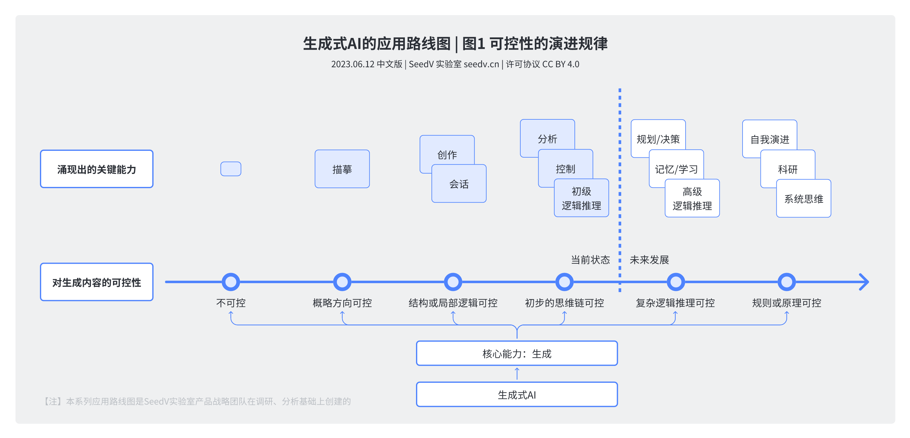
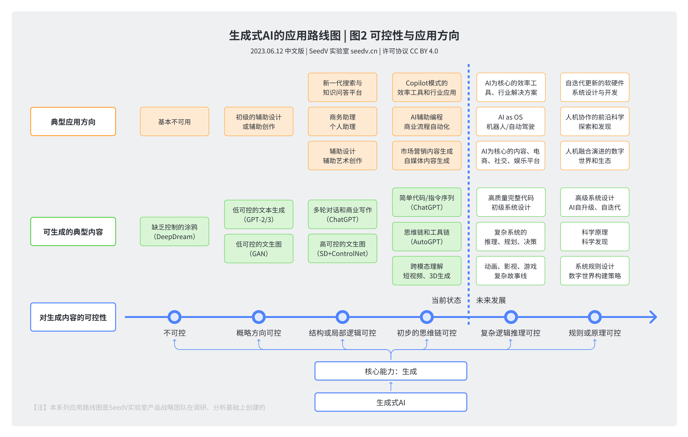
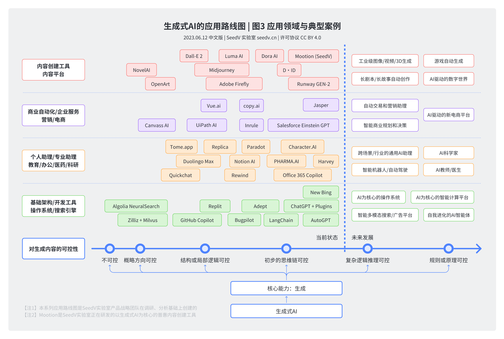
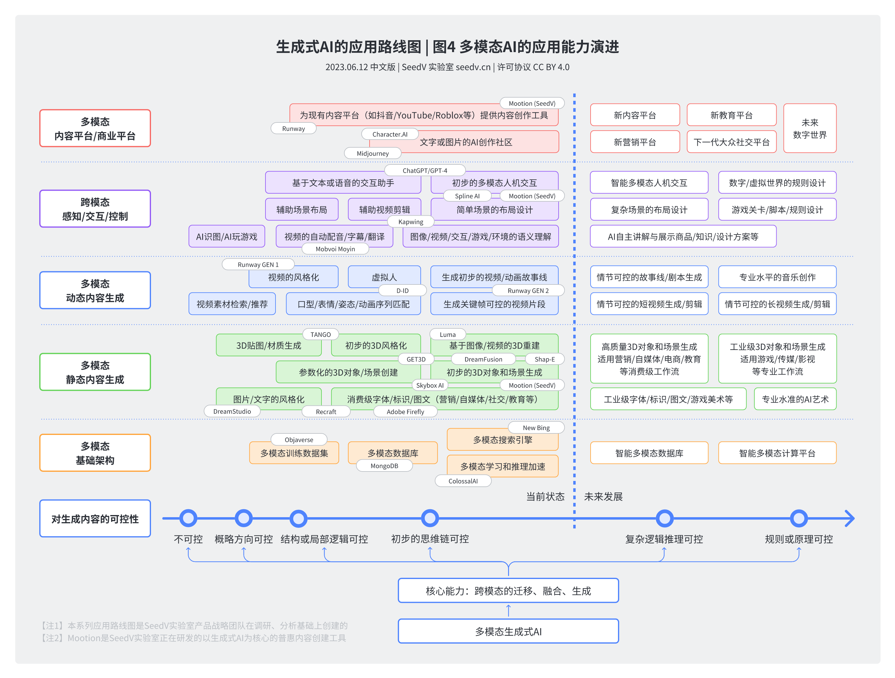

# 生成式AI的应用路线图 | The Roadmap of Generative AI

生成式AI的应用路线图：应用场景与典型案例。

本图集绘制于2023年6月，是基于当时LLM与生成式AI模型能力所做的一份预测性图表。以下每张图的说明文字，除了介绍图表本身的核心逻辑外，也会结合2024-2026年的实际发展做一些补充说明或更正。

## Localization

本图集的原始语言为中文。English translation: [README.en.md](./README.en.md).

## LICENSE

This work is licensed under a
[Creative Commons Attribution 4.0 International License](http://creativecommons.org/licenses/by/4.0/).

## 图1 可控性的演进规律

这张图绘制于2023年6月，试图捕捉生成式AI"可控性"这一核心维度的演进规律：从最初完全不可控的生成，到概略方向可控、结构与局部逻辑可控，再到当时刚刚显现的"初步思维链可控"，最终指向更远的复杂逻辑推理可控与规则/原理可控。图中把"当前状态"标记在初步思维链可控与复杂逻辑推理可控之间，将规划/决策、记忆/学习、高级逻辑推理，乃至自我演进、系统思维列为尚待实现的"未来发展"。

回头看2024-2026年的进展，这条演进曲线的方向是准确的，但速度超出了当初的预期：具备长链条推理能力的模型、可自主规划与执行的Agent，乃至能够在验证式奖励下自我校正的循环工程实践，已经把"复杂逻辑推理可控"变成了现实中的常态能力，部分前沿系统甚至开始触及"规则或原理可控"的边界。

## 图2 可控性与应用方向

这张图沿用图1的可控性坐标，进一步刻画了不同可控性水平所对应的典型应用方向与可生成内容——从早期辅助设计、辅助创作，到Copilot模式的效率工具与商业流程自动化，直至预测中"AI为核心的操作系统"、机器人与自动驾驶，以及能够自我迭代更新的软硬件系统。

三年后回看，Copilot模式与"AI辅助编程"已经成为主流工程实践的一部分，"AI as OS"的雏形也在计算机使用类Agent与操作系统级AI助理中初步显现；而当年被列为"未来发展"的自我迭代软硬件系统设计，正是本仓库另一图集[《2026：通向企业级AI能力的关键路径》](../enterprise-ai-critical-path/README.md)中"循环工程"与"AGI时代"所描述的能力——这张2023年的预测图，与三年后的路线图在逻辑上一脉相承。

## 图3 应用领域与典型案例

这张图以2023年中的视角，为可控性演进的每个阶段列举了具体的产品与创业公司案例——从Dall·E 2、Midjourney等内容创作工具，到LangChain、AutoGPT等早期Agent框架，再到ChatGPT Plugins这样的"AI as OS"雏形。这些案例是当时生成式AI创业生态的一张快照，而非一份历久弥新的名单。

三年多过去，这份名单中的不少产品已被整合、迭代甚至替代：例如以插件生态连接工具的方式，已经被更标准化的工具调用协议所取代；早期实验性的自主Agent框架，也演化为更成熟的工程范式（可参见本仓库[《2026：通向企业级AI能力的关键路径》](../enterprise-ai-critical-path/README.md)中对"挽具工程""循环工程"的讨论）。阅读这张图时，建议将关注点放在"可控性阶段与典型应用逻辑的对应关系"上，而非具体的产品名称本身。

## 图4 多模态AI的应用能力演进

这张图聚焦多模态AI，沿可控性坐标展开了内容平台、跨模态感知交互、动态内容生成、静态与3D内容生成、多模态基础架构五条线索，并预测了"情节可控的长视频生成""专业水平的音乐创作"以及能自主讲解、展示的AI等"未来发展"方向。

2024-2026年的多模态生成技术进展，在多数方向上验证甚至提前实现了这份预测：新一代视频生成模型已经能够生成具备可控情节与较长时长的连贯视频片段，音乐与语音生成也逐步逼近专业制作水准；相对滞后的是全自动、工业级的3D场景重建与实时虚拟世界搭建——这部分仍处在从"参数化3D生成"迈向"高质量3D场景生成"的过程中，尚未完全兑现图中对"未来发展"的设想。
