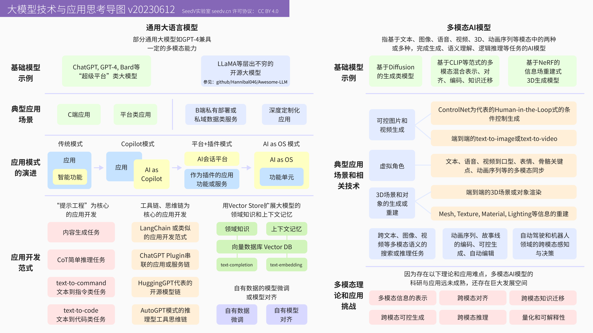

# 大模型技术与应用思考导图

大模型（LLM）与多模态AI的技术演进和应用思考导图。

本图绘制于2023年6月，是基于当时LLM与生成式AI模型能力所做的一份总结与预测性图表。本图集目前仅提供中文版本。

## LICENSE

This work is licensed under a
[Creative Commons Attribution 4.0 International License](http://creativecommons.org/licenses/by/4.0/).

## 大模型技术与应用思考导图

这张思考导图绘制于2023年6月，尝试用一张图梳理通用大语言模型与多模态AI模型的技术版图：左侧从ChatGPT/GPT-4等"超级平台"大模型与LLaMA为代表的开源模型出发，梳理了C端/B端应用场景，并总结出应用模式从传统应用、Copilot模式、平台+插件模式，到"AI as OS"模式的演进路径，以及以提示工程、工具链/思维链、向量数据库扩展记忆为核心的三类应用开发范式。右侧则聚焦多模态AI模型，从基于Diffusion、CLIP、NeRF的基础模型出发，梳理了可控图片/视频生成、虚拟角色、3D场景与对象生成等典型场景，并列出了多模态信息表示、跨模态对齐、跨模态知识迁移、跨模态可控生成、跨模态推理、量化与可解释性等当时被认为"远未成熟"的理论与应用挑战。

三年多后回看，这张图中的多数预测方向都得到了印证：应用模式的演进如期走向了"AI as OS"（并进一步演化出本仓库[《2026：通向企业级AI能力的关键路径》](../enterprise-ai-critical-path/README.md)中描述的Agent时代与循环工程范式）；提示工程、思维链与向量数据库/RAG，也确实构成了2023-2024年应用开发范式的主流。与此同时，也需要做一些更正：当年被列为开放挑战的跨模态对齐与可控生成，在2024-2026年间借助新一代多模态大模型与视频生成模型取得了显著突破，其成熟度已经超出了图中标注的预期；但跨模态推理与量化/可解释性等更基础的理论问题，即便在今天，仍然是学术界与工业界持续攻关的方向，并未如另一部分预测那样被迅速解决。
